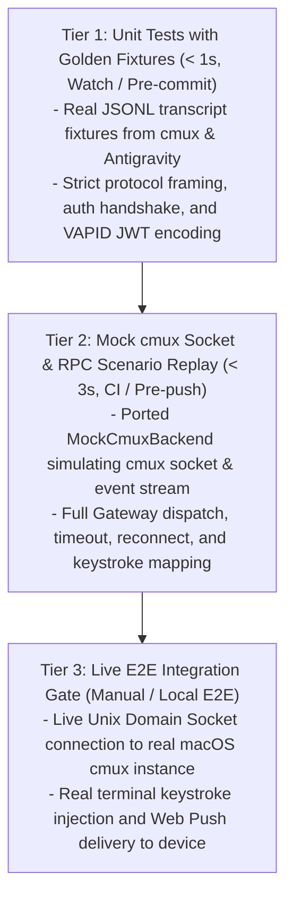

# CMUX-MOBILE TESTING & VERIFICATION STRATEGY

> **Standard:** 100% Evidence-based, strict zero-guessing, concrete citations with file paths and line numbers.  
> **Architecture:** 3-Tier Testing Gate (Golden Fixtures, Mock Socket Server, and Live E2E Integration).

---

## 1. TESTING PHILOSOPHY & THE 3-TIER TESTING GATE

To avoid the pitfalls of brittle manual testing and inaccurate mock hallucinations, **cmux-mobile** adheres to a disciplined 3-tier testing pyramid inspired directly by the verification suites of `cmux`, `orca`, and `cmux-pocket`:

---

## 2. TIER 1: UNIT TESTS WITH GOLDEN RECORDINGS (PARSER & PROTOCOL)

* **Execution Speed:** < 1 second. Runs on every file save in watch mode and in git pre-commit hooks.
* **Environment:** Pure Node.js / Bun / Vitest; 100% deterministic, zero OS dependencies.

### 2.1. Real JSONL Transcript Fixtures
Instead of inventing synthetic mock strings, we port authentic golden transcript lines directly from [`ref/cmux/agent-chat/test/transcript.test.ts:24-44`](./ref/cmux/agent-chat/test/transcript.test.ts#L24-L44):
- **User Prompts:** `{ type: "user", uuid: "u1", cwd: "/work/app", message: { role: "user", content: "..." } }`.
- **System Reminders / Meta:** `{ isMeta: true, message: { role: "user", content: "<system-reminder>...</system-reminder>" } }` (asserted ignored in UI).
- **Thinking / Reasoning Blocks:** `{ type: "assistant", uuid: "a1", message: { content: [{ type: "thinking", thinking: "..." }] } }`.
- **Tool Calls:** `{ type: "assistant", message: { content: [{ type: "tool_use", id: "t1", name: "Bash", input: { command: "..." } }] } }`.
- **Tool Outputs:** `{ type: "user", message: { role: "user", content: [{ type: "tool_result", tool_use_id: "t1", content: "...", is_error: true }] } }`.
- **Sub-Agent Chat:** `{ type: "assistant", isSidechain: true, message: { content: [{ type: "text", text: "..." }] } }` (asserted routed to `SubagentGroup`).
- **Compact Boundaries & Interruption:** `{ type: "system", subtype: "compact_boundary" }` and `{ message: { role: "user", content: [{ type: "text", text: "[Request interrupted by user]" }] } }`.
- **Antigravity (AGY) Transcripts:** Parsed from `<appDataDir>/brain/<id>/.system_generated/logs/transcript.jsonl`, validating step types (`USER_INPUT`, `PLANNER_RESPONSE`), `thinking`, and tool calls (`run_command`, `ask_question`, `ask_permission`).

### 2.2. Protocol Framing & Auth Handshake Tests
- Validates that initial WebSocket connection requires `{"op": "auth", "token": "..."}` frame within 5,000 ms ([`ref/cmux-pocket/crates/cmux-pocket-gateway/src/server.rs:310-340`](./ref/cmux-pocket/crates/cmux-pocket-gateway/src/server.rs#L310-L340)).
- Validates rejection on missing or invalid token closes with WebSocket Code `1008` (Policy Violation) and payload `{"op": "auth_error", "reason": "unauthorized"}`.
- Validates QR Pairing URI parser against `cmux-pocket://import?v=1&host=...&port=...&token=...` ([`ref/cmux-pocket/crates/cmux-pocket-cli/src/uri.rs:112-143`](./ref/cmux-pocket/crates/cmux-pocket-cli/src/uri.rs#L112-L143)).

---

## 3. TIER 2: MOCK CMUX SOCKET SERVER & RPC SCENARIO REPLAY

* **Execution Speed:** < 3 seconds. Runs in CI/CD (GitHub Actions) without requiring macOS or `cmux.app`.
* **Architecture:** An in-process `MockCmuxSocketServer` implementing cmux's Unix Domain Socket IPC wire protocol.

### 3.1. Porting `MockCmuxBackend` from cmux-pocket
We adapt the mock backend design from [`ref/cmux-pocket/crates/cmux-pocket-cmux/src/mock.rs:1-50`](./ref/cmux-pocket/crates/cmux-pocket-cmux/src/mock.rs#L1-L50) and [`ref/cmux-pocket/crates/cmux-pocket-cmux/tests/mock_operations_tests.rs:1-60`](./ref/cmux-pocket/crates/cmux-pocket-cmux/tests/mock_operations_tests.rs#L1-L60):
- **Workspace State:** Simulates `ws-main`, `ws-dev`, surfaces, tabs, and active flags.
- **IPC Command Handlers:**
  - `ping` $\to$ responds `PONG` or `ok`.
  - `workspace.tree` $\to$ returns full hierarchical workspace/surface JSON snapshot.
  - `send-key` $\to$ records received keystrokes (`\r` vs `1` vs `\x03`) into a test assertion buffer.
  - `events` $\to$ provides an async stream emitting Attention V1 notifications (`notify_target_async`, [`ref/cmux/CLI/FeedEventClassifier.swift:455-517`](./ref/cmux/CLI/FeedEventClassifier.swift#L455-L517)).

### 3.2. RPC Scenario Replay (Orca Methodology)
Adopting Orca's golden scenario recording standard ([`ref/orca/mobile/src/test-support/rpc-recording/README.md:1-100`](./ref/orca/mobile/src/test-support/rpc-recording/README.md#L1-L100)):
- Test scenarios replay recorded message exchanges:
  1. Client sends `mobile.chat.approve { surfaceId: "s1", agent: "claude" }`.
  2. Verify Gateway dispatches keystroke `"1"` to `MockCmuxSocketServer`.
  3. Client sends `mobile.chat.approve { surfaceId: "s2", agent: "antigravity" }`.
  4. Verify Gateway dispatches keystroke `"\r"` to `MockCmuxSocketServer`.
  5. Client sends `mobile.chat.interrupt { surfaceId: "s1" }`.
  6. Verify Gateway dispatches `"\x03"` (SIGINT).

### 3.3. Resilience & Failure Recovery Tests
- Simulates sudden socket closure: Gateway must transition to `reconnecting`, apply exponential backoff (500ms, 1000ms, 2000ms capped at 10s), and notify Web clients without crashing.
- Simulates rate limiting and backpressure when agent emits 5,000 log lines/second.

---

## 4. TIER 3: LIVE E2E INTEGRATION GATE (MAC & CMUX APP)

* **Execution Speed:** 10 – 30 seconds. Runs manually or in local integration checks.
* **Prerequisites:** Running macOS machine with `cmux.app` installed and active.

### 4.1. Verification Steps:
1. **Process & Socket Discovery:**
   - Detect running cmux (`pgrep -x cmux`).
   - Discover active Unix socket via [`ref/cmux/CLI/Client.swift:15-38`](./ref/cmux/CLI/Client.swift#L15-L38): `$TMPDIR/cmux-*-*.sock` or `$HOME/Library/Application Support/cmux/cmux.sock`.
2. **Permission Verification (`SocketControlMode`):**
   - Execute `cmux ping` through the Dual-Transport Bridge:
     - Verify fallback to CLI wrapper (`cmux rpc` / `cmux ping`) if socket mode is `cmuxOnly` ([`ref/cmux/Packages/macOS/CmuxSettings/Sources/CmuxSettings/Values/SocketControlMode.swift:9-21`](./ref/cmux/Packages/macOS/CmuxSettings/Sources/CmuxSettings/Values/SocketControlMode.swift#L9-L21)).
3. **Live Surface Creation & Keystroke Injection:**
   - Create a test surface (`cmux new-surface`).
   - Inject test echo command via Gateway (`cmux send-key`).
   - Verify output captured via `cmux read-screen`.
4. **Live Transcript Tailing:**
   - Launch real `antigravity-cli` or `claude` turn in the surface.
   - Verify Gateway immediately detects file modification and streams normalized `AgentEvent` frames over WebSocket.
5. **End-to-End Push Notification Delivery:**
   - Trigger a notification event.
   - Confirm push payload received by browser service worker and displayed as a system banner.

---

## 5. SUMMARY OF DIRECT CODEBASE BORROWINGS

| Component | Source Reference | Benefit |
| :--- | :--- | :--- |
| **Claude & Codex JSONL Fixtures** | `ref/cmux/agent-chat/test/transcript.test.ts:24-60` | Guarantees 100% transcript format compatibility with zero drift. |
| **Mock cmux Backend & State** | `ref/cmux-pocket/crates/cmux-pocket-cmux/src/mock.rs:1-50` | Eliminates need to run cmux in CI; enables fast, reproducible tests. |
| **RPC Scenario & Golden Replay** | `ref/orca/mobile/src/test-support/rpc-recording/README.md:1-100` | Provides deterministic replay for complex agent turn sequences. |
| **Antigravity Event Normalizer** | `ref/orca/src/shared/agent-hook-listener/providers/antigravity-events.ts:13-110` | Robust handling of `ask_question`, `ask_permission`, and sub-agents. |
