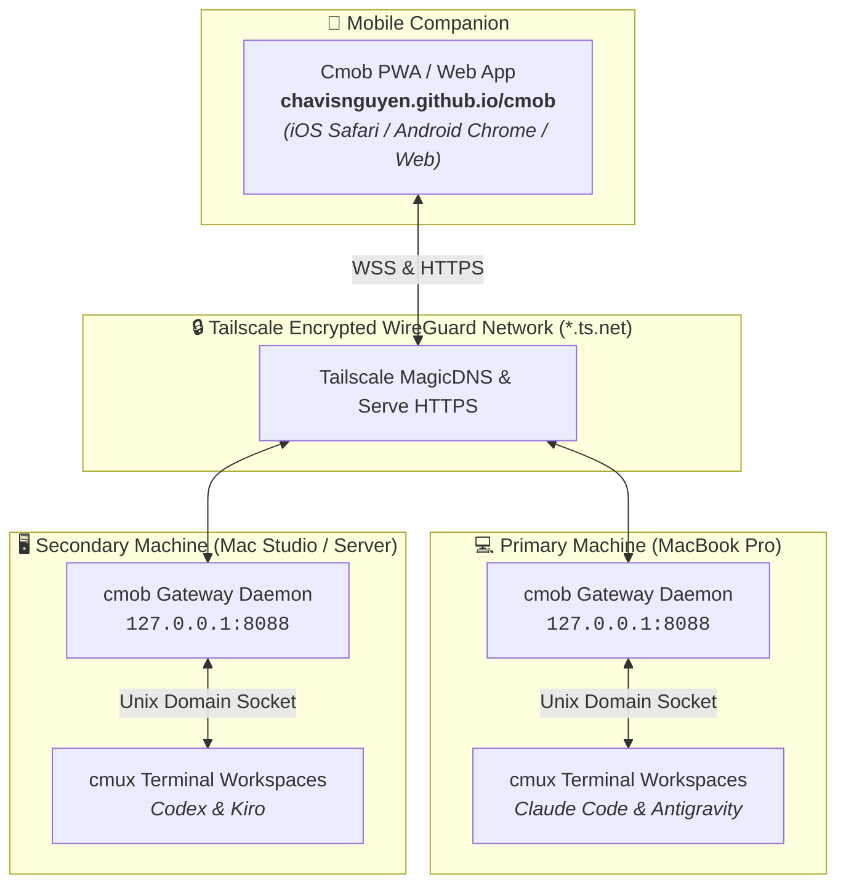
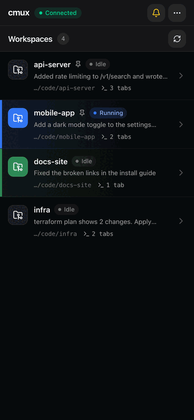

# cmob — Cmux Mobile

[](https://github.com/chavisnguyen/cmob/releases)
[](https://chavisnguyen.github.io/cmob/)
[](./LICENSE)
[](https://tailscale.com/)

**Watch and control your AI coding agents & cmux workspaces from your phone.**  
Unified mobile companion (iOS, Android, and Web PWA) for [cmux](https://cmux.com/), inspired by Orca for Claude Code, Antigravity (AGY), Codex, and Kiro.

📱 **Official Web & PWA App:** [https://chavisnguyen.github.io/cmob/](https://chavisnguyen.github.io/cmob/)  
🎮 **Live Interactive Demo (Zero-setup):** [https://chavisnguyen.github.io/cmob/?demo=1](https://chavisnguyen.github.io/cmob/?demo=1)

---


*Invented demo projects. cmob runs against your real cmux workspaces and coding agents.*

---

## Highlights

- 🌐 **Single Central PWA ([chavisnguyen.github.io/cmob](https://chavisnguyen.github.io/cmob/))**: Install once on your phone's Home Screen and control all your computers in one place. No domain fragmentation or lost settings.
- 💻 **Multi-Device Tab Strip (Orca-Style)**: Switch seamlessly between your MacBook, Mac Studio, or Cloud Devbox with a single tap. Live indicator dots reflect each machine's connection state.
- 💬 **Agent-Aware Chat UI**: Formatted markdown, syntax-highlighted code blocks, interactive startup choice dialogs, tool execution pills, collapsible reasoning blocks, and subagent collaboration cards.
- ⚡ **Instant Remote Control**: Send instructions, approve permission prompts, interrupt stuck agent turns, dictate voice prompts, attach photos from your phone camera, or run slash commands.
- 🔔 **Real-Time Push Notifications**: Web Push (RFC 8291 / RFC 8292 VAPID) alerts wake your phone when background coding agents need approval, finish a turn, or report errors.
- 🖥️ **Full Hardware-Accelerated Terminal**: Integrated xterm.js terminal with a phone-optimized key bar (`Ctrl`, `Alt`, `Esc`, `Tab`, arrow keys, function keys).
- 🔒 **Zero-Trust & Private**: Securely routed through your private [Tailscale](https://tailscale.com/) network (`*.ts.net`) or loopback. Zero open ports to the public internet. Single-use pairing tickets with cryptographically secure per-device tokens.

---

## Architecture & Multi-Device Topology



---

## Quick Start (60 Seconds)

### Prerequisites

1. A Mac with the [cmux](https://cmux.com/) application installed.
2. [Tailscale](https://tailscale.com/) installed and signed in on both your Mac and your phone.

### Step 1: Install `cmob` on your Mac

```bash
brew tap chavisnguyen/cmob
brew install cmob
```

*(Or download prebuilt binaries directly from [GitHub Releases](https://github.com/chavisnguyen/cmob/releases)).*

### Step 2: Set up in cmux

In a terminal **inside cmux**:

```bash
cmob setup            # One-time setup: installs autostart hook into cmux
cmob qr --tailscale   # Starts the gateway and prints a secure pairing QR code
```

### Step 3: Open on your phone

1. Open **[https://chavisnguyen.github.io/cmob/](https://chavisnguyen.github.io/cmob/)** on your phone (Safari on iOS or Chrome on Android).
2. Tap **Share** → **Add to Home Screen** to install it as a standalone app.
3. Tap **Connect Your Computer** and scan the QR code displayed in your terminal (or open the companion link directly).
4. **Repeat `cmob qr --tailscale` on your other computers** to add them as additional tabs in the top device strip!



---

## Check System Status

Check gateway health, cmux connectivity, and connected devices at any time:

```bash
cmob status
```

```text
Gateway     ✓ running on 127.0.0.1:8088 (v0.1.5)
cmux        ✓ connected
Autostart   ✓ installed
Tailscale   ✓ https://your-mac.your-tailnet.ts.net
Connected   1 client
  - device          Safari · iPhone    up 5m
Paired      2 devices (cmob devices)
```

---

## Command Reference

| Command | Description |
|---|---|
| `cmob setup` | One-time setup: configures autostart inside cmux. Safe to re-run. |
| `cmob qr --tailscale` | Generates a single-use pairing QR code via Tailscale HTTPS. Run again to pair more devices. |
| `cmob qr` | Generates a local loopback pairing QR code (`http://127.0.0.1:8088`). |
| `cmob status` | Displays gateway status, cmux socket health, Tailscale domain, and active clients. |
| `cmob devices` | Lists all paired mobile devices and their last-seen timestamps. |
| `cmob devices revoke <id>` | Immediately revokes a device token and disconnects that device. |
| `cmob start` / `stop` / `restart` | Controls the background gateway daemon. |
| `cmob logs [-f]` | Views or follows live gateway server logs. |
| `cmob uninstall` | Removes autostart hooks and terminates the background gateway. |

---

## Supported AI Coding Agents

`cmob` features deep protocol awareness, structured turn classification, and transcript parsing for:

| Agent | CLI / Binary | Features & Capabilities |
|---|---|---|
| **Antigravity (AGY)** | `agy` | Structured subagent cards, reasoning fold-outs, status detection, adaptive submit delay. |
| **Claude Code** | `claude` | Tool-use badges, live turn streaming, quiet-window completion debounce, permission approval prompt cards. |
| **Codex** | `codex` | Interactive trust & folder approval dialogs, rollout pagination, numbered choice keys. |
| **Kiro** | `kiro` | Unresolved tool confirmation handling, session index polling, hook merge tracking. |

*(OpenCode, Grok, Gemini CLI, and Aider are also automatically detected, with full terminal fallback).*

---

## Security & Privacy Architecture

- **Private Network Only:** The gateway binds to `127.0.0.1`. Remote access is routed strictly through Tailscale WireGuard tunnels.
- **Strict CORS & Host Verification:** The gateway enforces DNS-rebinding protection and restricts CORS headers strictly to same-origin requests, loopback addresses, Tailscale MagicDNS nodes, and the official PWA host (`chavisnguyen.github.io`).
- **Single-Use Cryptographic Pairing:** Pairing offers contain single-use tickets that are redeemed at `/api/pair/exchange` for random 256-bit device bearer tokens. Tickets expire automatically and replay attempts are rejected.
- **Zero Third-Party Telemetry:** No user analytics, no tracking pixels, and no external servers. Notifications use standard VAPID Web Push directly from your machine to Apple APNs or Google FCM.

> [!WARNING]
> Anyone with access to a paired device can read and type into your terminal sessions and execute commands. Only pair devices that you personally own and trust.

---

## Documentation

- [Security Architecture](docs/security.md): Detailed token lifecycle, cryptographic exchange, and storage isolation.
- [Troubleshooting Guide](docs/troubleshooting.md): Solutions for `ERR_NAME_NOT_RESOLVED`, empty workspace lists, camera permissions, and Tailscale Serve SNI.
- [Configuration Reference](docs/configuration.md): Complete list of environment variables (`CMUX_ALLOWED_ORIGINS`, `CMUX_PORT`, etc.).
- [Development Guide](docs/development.md): Instructions for building from source, running the test suite, and releasing formulas.

---

## Credits & Inspiration

- Built for the [cmux](https://github.com/manaflow-ai/cmux) macOS terminal workspace multiplexer.
- UI & UX concepts inspired by [Orca](https://github.com/stablyai/orca) and [cmux-pocket](https://github.com/shiquda/cmux-pocket).

---

## License

[MIT](LICENSE) © 2026 Chavis Nguyen
