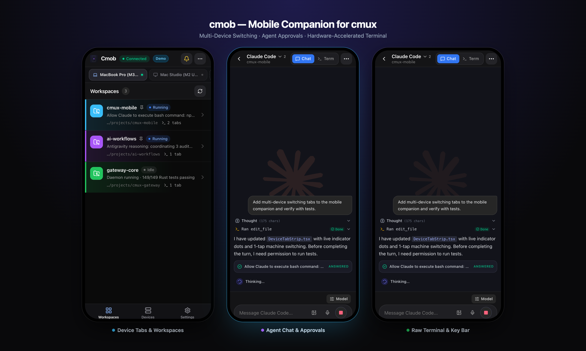
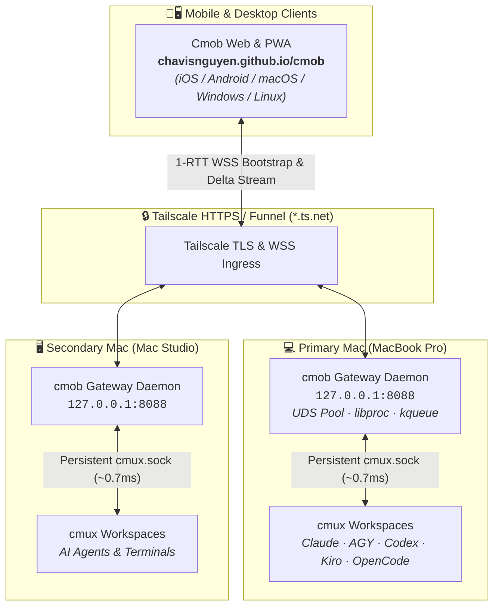

# cmob — Cmux Mobile & Desktop Companion

[](https://github.com/chavisnguyen/cmob/releases)
[](https://chavisnguyen.github.io/cmob/)
[](./LICENSE)
[](https://tailscale.com/)

**Watch and control your AI coding agents & [cmux](https://cmux.com/) workspaces from your phone, tablet, or desktop browser.**  
Unified **Mobile (iOS & Android PWA)** and **Adaptive Desktop Web Companion** for `cmux`, inspired by Orca for **Claude Code**, **Antigravity (AGY)**, **Codex**, **Kiro**, and **OpenCode**.

📱 **Official Web & Desktop/Mobile PWA:** [https://chavisnguyen.github.io/cmob/](https://chavisnguyen.github.io/cmob/)  
🎮 **Live Interactive Demo (Zero-setup):** [https://chavisnguyen.github.io/cmob/?demo=1](https://chavisnguyen.github.io/cmob/?demo=1)

---



*Invented demo projects. cmob runs against your real cmux workspaces and coding agents.*

---

## Highlights

- 🖥️ **Adaptive Desktop & Mobile Companion**:
  - **Desktop / Tablet (`≥1024px`)**: Full-width native `cmux`-styled split-pane workspace IDE — collapsible sidebar with custom workspace accent bars, horizontal multi-tab surface strip, inline AI quota pill, Git diff drawer, and fluid full-width chat/terminal views.
  - **Mobile (`iOS Safari` & `Android Chrome` PWA)**: Touch-first navigation stack, thumb-friendly bottom dock, haptic feedback, and lock-screen Web Push notifications.
- 💬 **Native Orca-Style Agent Chat UI**:
  - Rich GFM Markdown & code blocks, grouped tool execution sentences, collapsible reasoning/thinking blocks with live duration timers, live subagent & background task cards (`BackgroundWorkStrip`), and auto-hiding completed task checklists.
  - **Interactive Question & Approval Cards**: Answer multi-step TUI wizards (`ask_question` / `AskUserQuestion` with single-select, multi-select, and custom write-in options), approve/deny tool permissions, or answer startup trust/model dialogs directly from Chat.
  - **Session Controls**: Launch new tabs (`+ Tab`) with per-agent **Model & Effort** selectors, switch models mid-session, queue follow-up prompts while an agent is working, upload images/screenshots (`.png`, `.jpg`, `.webp`, `.heic`), or **Fork** an active conversation into a fresh tab.
- 📊 **Live AI Quota & Usage Dashboard**: Real-time session and weekly quota tracking with reset countdowns across **Claude Code**, **Codex**, and **Antigravity (AGY)** model pools — accessible from both the dedicated **Usage** tab and the desktop top-bar pill.
- 🌿 **Built-in Git Changes & Diff Viewer**: Inspect modified, staged, untracked, and renamed files per workspace with unified syntax-colored diffs (`Changes` button) without leaving the chat.
- 🔵 **Native `cmux` Unread Notification Badges**: Live `#0A84FF` unread count badges synced directly with `cmux` across workspaces and tabs, automatically marking `cmux` notifications read as soon as you view the surface.
- ⚡ **Pure Raw-Speed Engine (Zero Subprocess Overhead)**:
  - **Persistent Pooled UDS Bridge (`cmux.sock`)**: 4-slot `UnixStream` pool speaking native `_cmux_capability_v1` JSON-RPC (~`0.6–0.9 ms` per call, zero CLI fork/exec).
  - **macOS Kernel Process Scanner (`<libproc.h>` + `KERN_PROCARGS2`)**: Direct in-memory TTY agent liveness inspection in ~`1.5 ms`.
  - **Event-Driven `kqueue` (`EVFILT_VNODE`) Streaming**: Sub-`10 ms` live delta updates (`turn_digest` diffing) + $O(\log N)$ tail-window reader for multi-MB transcripts.
  - **1-RTT WebSocket Auth Bootstrap (`bootstrap.v1`)**: Authenticates, loads the full workspace tree, and streams the initial chat snapshot in a **single round-trip**, paired with code-split client bundles (~`124 KB` gzip initial entry).
- 🖥️ **Hardware-Accelerated Live Terminal**: Full `cmux.render-grid.v1` + `xterm.js` (WebGL) terminal with mobile/desktop viewport sizing, pinch-zoom, scrollback, and a sticky modifier accessory bar (`Ctrl`, `Alt`, `Esc`, `Tab`, arrows).
- 🔒 **Zero-Trust & Private**: Bound strictly to `127.0.0.1` and exposed only via your encrypted [Tailscale](https://tailscale.com/) network/Funnel (`*.ts.net`). Single-use pairing tickets mint revocable 256-bit per-device tokens.

---

## Architecture & Multi-Device Topology



---

## Quick Start (60 Seconds)

### Prerequisites

1. A Mac running [cmux](https://cmux.com/).
2. [Tailscale](https://tailscale.com/) installed and signed in on your Mac (for remote HTTPS/mobile access).

### Step 1: Install `cmob` on your Mac

```bash
brew tap chavisnguyen/cmob https://github.com/chavisnguyen/cmob
brew install cmob
```

*(Or download prebuilt `arm64` / `x64` binaries from [GitHub Releases](https://github.com/chavisnguyen/cmob/releases)).*

### Step 2: Set up inside `cmux`

In any terminal **inside cmux**:

```bash
cmob setup            # One-time setup: generates token, installs autostart hook, starts gateway
cmob qr --tailscale   # Enables Tailscale HTTPS and prints a single-use pairing QR + URL
```

### Step 3: Connect from Phone or Desktop

- **On Mobile (iOS / Android):**
  1. Open **[https://chavisnguyen.github.io/cmob/](https://chavisnguyen.github.io/cmob/)** in Safari (iOS) or Chrome (Android).
  2. Tap **Share → Add to Home Screen** to install as a standalone PWA (required by iOS for lock-screen Web Push).
  3. Scan the QR code from `cmob qr --tailscale` (or open the printed pairing link).
- **On Desktop (macOS / Windows / Linux):**
  1. Open the printed pairing URL directly in Chrome, Safari, Arc, or Edge (or open `http://127.0.0.1:8088` locally on the same Mac) — `cmob` automatically switches to the multi-pane desktop workspace layout (and can also be installed as a standalone desktop app via your browser's **Install App** button).
- **Multiple Computers:** Run `cmob qr --tailscale` on any additional Mac to add it to the host switcher!


---

## Check System Status

Check gateway health, `cmux` socket connectivity, Tailscale state, and active desktop/mobile clients at any time:

```bash
cmob status
```

```text
Gateway     ✓ running on 127.0.0.1:8088 (v0.2.5)
cmux        ✓ connected
Autostart   ✓ installed
Tailscale   ✓ https://your-mac.your-tailnet.ts.net (Funnel)
Connected   2 clients
  - Mac            Chrome · macOS     up 12m
  - iPhone (app)   Safari · iPhone    up 5m
Paired      3 devices (cmob devices)
```

---

## Command Reference

| Command | Description |
|---|---|
| `cmob setup` | One-time setup (run inside `cmux`): creates gateway token, installs `.zshrc` autostart hook, and starts the daemon. |
| `cmob qr --tailscale` | Enables Tailscale HTTPS/Funnel and prints a single-use pairing QR code & URL for phones or remote desktops. |
| `cmob qr` | Prints a local loopback pairing QR code & URL (`http://127.0.0.1:8088`). |
| `cmob status` | Shows gateway version, `cmux.sock` health, Tailscale URL, live connected clients, and paired device count. |
| `cmob devices` | Lists all paired mobile/desktop devices with creation and last-seen timestamps. |
| `cmob devices revoke <id>` | Immediately revokes a device token and closes any active WebSocket sessions for that device. |
| `cmob start` / `stop` / `restart` | Starts, stops, or restarts the background gateway daemon (auto-refreshing stale socket capabilities if `cmux` restarted). |
| `cmob logs [-f]` | Prints or follows `~/.cmux/gateway.log`. |
| `cmob uninstall` | Removes the autostart shell hook and stops the background gateway. |

---

## Supported AI Coding Agents

`cmob` provides native transcript parsing, live `kqueue` delta streaming, TUI dialog/question automation, and per-agent input profiles for:

| Agent | CLI / Binary | Native Capabilities |
|---|---|---|
| **Antigravity (AGY)** | `agy`, `agys` | FIFO parallel tool pairing, subagent & background task cards with live elapsed timers, thinking duration, multi-question `ask_question` wizard answers, model picker, live quota buckets. |
| **Claude Code** | `claude` | Streaming tool runs, `AskUserQuestion` receipts & interactive answers, permission approval cards, context compaction markers, model/effort flags, session fork, 5h & 7d usage windows. |
| **Codex** | `codex` | Parent-to-subagent rollout resolution, interactive folder-trust & model-upgrade startup dialogs, patch diff cards, model/effort launch & mid-session controls, live quota tracking. |
| **Kiro** | `kiro-cli`, `kiro` | Live PID/TTY lease discovery, structured tool confirmation prompts, real-time transcript tailing without requiring external shell hooks. |
| **OpenCode** | `opencode` | Direct SQLite session/message/part reader, live `question` tool wizard cards, double-`Escape` turn interruption, model launch options. |

*(Additional terminal agents such as Gemini CLI, Aider, Amp, Cursor Agent, and plain shells are automatically recognized with full hardware-accelerated terminal control).*

---

## Security & Privacy Architecture

- **Loopback-Bound Gateway:** Listens on `127.0.0.1:8088` by default; remote traffic enters exclusively over TLS via Tailscale.
- **Native `cmux` Capability Auth:** Speaks directly to `cmux.sock` using `cmux`'s `_cmux_capability_v1` token without opening TCP ports between `cmob` and `cmux`.
- **Strict Host, Origin & Frame Guards:** Enforces DNS-rebinding checks, origin allowlists (`localhost`, Tailscale MagicDNS, `chavisnguyen.github.io`), constant-time token comparison, and periodic live token revocation checks.
- **Single-Use Cryptographic Pairing:** QR codes carry short-lived single-use tickets exchanged at `POST /api/pair/exchange` for 256-bit random device tokens stored with `0600` permissions in `~/.cmux/devices.json`.
- **Session-Scoped Client RAM State & Zero Telemetry:** Workspace and transcript caches live strictly in browser session RAM (no stale sensitive transcripts persisted in `localStorage`). Web Push notifications go directly from your Mac to Apple APNs / Google FCM via VAPID (RFC 8292) with zero third-party relay servers.

> [!WARNING]
> Anyone with access to a paired device can view your workspaces and send input to your terminals and coding agents. Only pair devices you own and trust, and revoke lost devices immediately via the **Devices** tab or `cmob devices revoke <id>`.

---

## Documentation

- [Security Architecture](docs/security.md): Token lifecycle, single-use ticket exchange, and origin guards.
- [Troubleshooting Guide](docs/troubleshooting.md): Solutions for connectivity, Tailscale Funnel, camera QR scanning, and iOS PWA push setup.
- [Configuration Reference](docs/configuration.md): Environment variables (`CMUX_GATEWAY_PORT`, `CMUX_SOCKET_PATH`, etc.).
- [Development Guide](docs/development.md): Building from source, running client (`vp check`, `vp test`) & Rust (`cargo test`) suites, and cutting Homebrew releases.

---

## Credits & Inspiration

- Built for [cmux](https://github.com/manaflow-ai/cmux) — the macOS terminal workspace multiplexer for coding agents.
- Inspired by [Orca](https://github.com/stablyai/orca) and [cmux-pocket](https://github.com/shiquda/cmux-pocket).

---

## License

[MIT](LICENSE) © 2026 Chavis Nguyen
